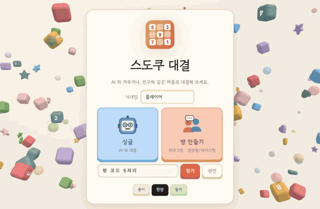

# 스도쿠 대결 (Sudoku Duel)

점심 먹고 남은 시간, 동료들과 같은 퍼즐로 한 판 붙어 보세요.



## 바로 하기

https://77hdumat.github.io/sudoku-duel/

## 같이 하기

1. 닉네임을 정하고 **방 만들기**를 눌러요.
2. 링크를 복사해 동료에게 공유하세요. 동료가 링크를 누르면 대결 준비는 끝!
3. 방장이 규칙과 난이도를 고르고 대결을 시작하세요.

| 규칙 | 설명 |
| --- | --- |
| 레이스형 | 같은 퍼즐을 각자 풀고, 먼저 끝낸 순서로 순위를 매겨요. |
| 점령형 | 한 판을 다 같이 채우고, 먼저 맞힌 사람이 그 칸을 가져가요. |
| 아이템전 | 연속으로 맞히면 상대 화면을 잠깐 가릴 수 있어요. |

혼자 할 때는 **싱글**을 눌러 꼬마봇(초급)부터 변성대왕까지 다섯 봇 중 하나를 골라보세요.

## 조작

| 키 | 동작 |
| --- | --- |
| 클릭, 방향키 | 칸 선택 |
| 1~9 | 숫자 입력 |
| Backspace, 0 | 지우기 |
| N | 메모 모드 |
| H | 힌트 |
| Z | 되돌리기 |

## 직접 실행

```bash
npm install
npm run dev    # 브라우저 개발 서버 http://localhost:5190
npm run app    # 데스크톱 앱 실행
npm run dist   # macOS .dmg 생성
```
